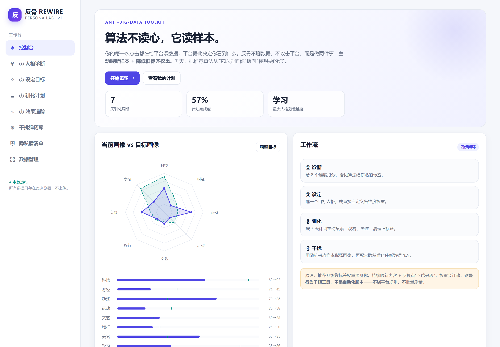
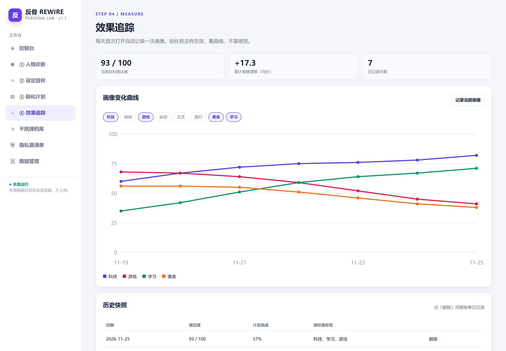

# 反骨 REWIRE

> 把「改变你的互联网人格」从一句话变成一套可执行、可打卡、可测量的 7 天计划。



反骨是一个**纯本地、零依赖**的单文件网页应用。它不删数据、不攻击平台、不跑自动化脚本；它帮你做三件事：**主动喂新样本**、**给旧标签负反馈**、**用噪声稀释画像**，然后用曲线验证有没有生效。

## 为什么做这个

开源圈里相关的东西分两类，但都不是给普通人用的成品：

- **混淆类**：TrackMeNot（随机搜索词，已停维护）、AdNauseam（模拟点击广告，6.8k star）——只做单一动作，没有目标设定和进度管理。
- **研究类**：ARLib（推荐系统数据投毒框架，配套综述论文）——面向论文实验，不是日常工具。

缺的是一个闭环：**我想变成什么样 → 我这周具体做什么 → 做完有没有变化**。反骨补的就是这一环。

## 功能

| 模块 | 内容 |
|---|---|
| ① 人格诊断 | 八维兴趣强度滑杆 + SVG 雷达图；可从官方导出文件自动推断画像 |
| ② 设定目标 | 6 套预设人格（开发者 / 健身 / 考研 / 文艺 / 投资 / 游戏）+ 自定义，实时算落差 |
| ③ 驯化计划 | 按差值生成 7/14 天任务：主动搜索、完播互动、连点「不感兴趣」、隐私阻断；逐项打卡 |
| ④ 效果追踪 | 每日自动快照，折线图看维度漂移、目标接近度与计划完成率 |
| 干扰弹药库 | 干扰搜索词 / 伪装兴趣标签 / 破茧话题包；**反馈驱动的查询演化引擎** |
| 隐私盾 | 12 项实操清单，7 个官方入口一键跳转 + 10 条设置路径一键复制 |
| 数据管理 | localStorage 持久化，JSON 导出 / 导入 / 重置 |
| PWA | 可安装到桌面、离线打开；Service Worker 缓存核心资源 + 三尺寸图标 |



## 快速开始

```bash
# 方式一：直接打开
双击 index.html

# 方式二：本地服务（可选）
python -m http.server 8000
# 浏览器访问 http://localhost:8000
```

无需安装依赖、无需账号、无需联网。所有数据保存在浏览器 `localStorage`（键名 `rewire_state_v1`），换设备前用「数据管理 → 导出备份」保存 JSON。

`file://` 直接打开可用全部功能；**PWA 安装与离线缓存需要 HTTP(S)**。用方式二启动本地服务，或部署到 GitHub Pages 后打开。浏览器识别到可安装应用时会显示「安装到桌面」按钮，侧边栏出现「可离线使用」角标。

## 官方数据导入

打开 Google Takeout → 我的活动 / YouTube，下载 ZIP 后解压；把 `MyActivity.json`、`watch-history.json`、`watch-history.html` 或 TikTok 搜索历史导出文件拖进「人格诊断 → 从官方导出数据诊断」。也接受通用 JSON / CSV / TXT。

解析器按 key 白名单取 `title` / `query` / `text` / `subtitles` 等文本，跳过 URL、时间戳和 ID；中英双语词典把文本映射到八维，每条文本每维最多计一次，最后按 `log1p(次数)` 归一化到 0–100。结果只预览，点「应用到当前画像」或「设为目标画像」才写入。

这是**参考值不是真值**：词典命中不等于真实兴趣，平台导出本身也不完整。它解决的是「手填画像完全靠主观」的问题，不是替你做诊断。

## 隐私盾深链

12 项清单中，7 项带官方入口（抖音、小红书、B 站、淘宝、微信官网、Firefox 容器插件、DuckDuckGo），点击直接在新标签打开；10 项带设置路径，点击「复制路径」可粘贴到手机或浏览器地址栏。国内 App 的个性化设置大多没有公开网页深链，因此**保留精确路径文字而不是伪造跳转**——这是刻意的设计取舍。

## 查询演化引擎

干扰弹药库不是固定词表。生成 12 条搜索词后，每条都可以标记：

- **✓ 有用**：该词权重 `+1.5`（上限 5），并用模板衍生 2 条下一跳查询，如 `Python 自动化脚本 → Python 自动化脚本 常见误区`，标记为「演化」进入候选池。
- **✕ 淘汰**：权重乘 `0.35`（下限 0.05），后续被抽中的概率显著下降。
- 采样按权重进行，并对目标人格里的高权重视角额外 `1.25×` 加权。

演化词上限 120 条，反馈历史保留 200 条，避免无限膨胀。设计参考 TrackMeNot 的「动态查询机制」：从结果里解析出逻辑上相关的后续词，让查询链随设备演化，而不是机械重复。

## 架构

单文件 `index.html`，原生 HTML / CSS / JavaScript：

- 雷达图、折线图均为手写 SVG，不依赖 Chart.js 或 CDN。
- 状态对象 `state` 统一持久化：`current` / `target` / `plan` / `planChecks` / `shield` / `evo` / `snapshots`。
- 随机源为确定性 LCG，同一 seed + 画像可复现同一批弹药；反馈权重单独存储。
- 导入解析全部在浏览器内完成（`File.text()` + `DOMParser` + 自写 CSV 切分），无第三方库、无网络请求。
- 响应式：桌面侧边栏，移动端横向标签导航。
- PWA 三件套：`manifest.json`、`sw.js`、`icon-*.png`；缓存优先，离线时回退到首页。`file://` 下自动跳过注册，不影响本地使用。

## 边界与风险

- **工具只提供清单，动作由你手动完成**。不模拟点击、不批量刷量、不调用平台非公开接口。
- 噪声只能稀释，不能清零。真正有效的是「持续负反馈 + 关掉个性化推荐 + 场景分离」。
- 自动化点击类工具可能违反平台条款（AdNauseam 曾被 Google 商店下架）；本工具刻意避开这条路。
- 浏览器清缓存会丢本地数据，重要进度请定期导出 JSON。

## 路线图

- [x] 八维诊断与目标模板
- [x] 7/14 天计划与打卡
- [x] 反馈驱动的查询演化
- [x] 每日快照与效果曲线
- [x] JSON 备份 / 恢复
- [x] 隐私盾平台跳转 + 设置路径复制
- [x] PWA 离线安装
- [x] 导入 Google Takeout / TikTok 官方兴趣数据作为诊断输入
- [ ] 安装后的每日提醒（Web Notifications）
- [ ] 匿名聚合的效果基准（验证哪类动作真正有效）

## 参考

- [TrackMeNot](https://github.com/vtoubiana/TrackMeNot) — NYU，随机搜索混淆，GPL-2.0，已停止维护
- [AdNauseam](https://github.com/dhowe/AdNauseam) — 模拟点击广告混淆画像，GPL-3.0，活跃
- [ARLib](https://github.com/CoderWZW/ARLib) — 推荐系统投毒攻击研究框架
- Wang et al., *Poisoning Attacks and Defenses in Recommender Systems: A Survey*, [arXiv:2406.01022](https://arxiv.org/abs/2406.01022)
- Finn Brunton & Helen Nissenbaum, *Obfuscation: A User's Guide for Privacy and Protest*

## License

MIT © 2026 John-J
